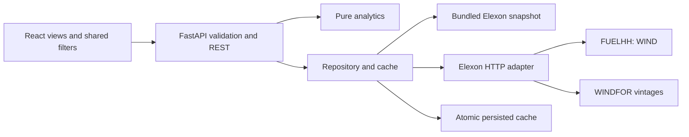

# Technical review

## Responsibilities

`api/routes.py` validates one common filter contract and composes a typed analysis response. `analytics.py` is pure and does not perform HTTP or persistence. `repository.py` controls cached source data and normalizes source records. `elexon.py` is the only module that knows the upstream API shape. Pydantic models define source invariants and outgoing comparison/metric schemas. React owns presentation, not selection, metrics or business observations.

## Selection invariant

For delivery T on local day D, compute C = local D−1 at configured HH:MM and convert to UTC. Candidates are exact-target records published no later than C, plus a possible :00 record for T at :30 if that publication is hourly. Pick the greatest publication time; within the same publication prefer the exact target. Store delivery, cutoff, selected publication, source target, alignment and lead hours in every response row. The late-publication test includes records one second after cutoff and on delivery day to prove they cannot enter analysis.

No eligible forecast is represented as missing. No adjacent-hour gap is bridged. Exact zero generation is valid; null generation, negative/non-finite/bool values and naive/off-grid delivery times are invalid. Latest retrieved publication wins for revised actuals. Conflicting same-target/same-publication values are quarantined; identical duplicates are removed and counted.

Forecast `lead_hours = (delivery_time − publish_time)` is distinct from `(delivery_time − decision_time)`. The UI displays both publication and cutoff so these concepts remain separate.

## Metric population

All selected expected half-hours are returned, including missing pairs. Only matched pairs enter accuracy/error metrics and the distribution. Daily/time-of-day breakdowns use the same rows and metric function; no aggregation is recomputed by JavaScript. Mean forecast/actual level fields use all available values of their respective series, not just matched pairs, and are not percentage-error denominators. CSV preserves nulls and enough provenance fields to reproduce each row.

The nearest-rank P90 is calculated on absolute errors. MAPE uses nonzero actual pairs; WAPE includes all matched absolute errors and is undefined at zero total actual. Percentage error in the interval table is **signed**; MAPE and WAPE are **absolute**. Mean error and forecast bias are the same quantity here and are not duplicated as separate KPIs.

## Request and refresh lifecycle

1. The browser fetches safe default configuration and `/api/dashboard` with the active filter parameters. Filter changes abort superseded requests and clear stale chart data, showing skeletons.
2. On first read, the repository chooses the newest valid persisted cache or bundled snapshot. If none are valid, it fetches Elexon. Ordinary reads do not fetch upstream repeatedly.
3. Manual refresh is a POST. Public/proxied deployments require a constant-time compared refresh token; direct local development can refresh without one. The token is never present in browser bundles, query strings or persistent browser storage.
4. The adapter fetches bounded publication chunks with four concurrent requests. Up to three attempts, exponential delay, finite request timeout. A complete extract is validated before replacement.
5. Substantially truncated refreshes are rejected relative to existing cache record counts. Valid data are written to a temporary file and atomically replaced. Persistence failure still permits a process-local cache with a visible warning.
6. A failed refresh retains the last good dataset and surfaces a safe explanation. Data age beyond 24 hours is flagged; there is deliberately no hidden background job.

Health is liveness, not an upstream availability guarantee. A response with zero matched pairs is a valid empty analysis, while unavailable/invalid source data return 503. Unexpected exceptions are logged server-side and return a generic 500 message. CORS allows explicit origins only.

## Hosting

Local development uses Vite's `/api` proxy. Docker uses an unprivileged Nginx frontend, unprivileged Python service, health-gated startup and persisted cache volume. The same-origin Vercel entrypoint exports FastAPI and mounts the built React app after API routes. Frontend calls use relative `/api` URLs, so there is no production localhost dependency and no cross-origin configuration by default.

Vercel caches are ephemeral/per instance; a refresh is not a distributed update to all cold instances. Every instance can still use the genuine bundled January snapshot. Shared storage and multi-process locking are intentionally left for a later multi-user product. No live deployment or Docker run is inferred from configuration alone.

## Frontend and design decisions

Four hash-navigated views keep a small pilot understandable. A single abortable fetch hook supplies all views; local component state handles table sorting/search/pagination and filter expansion. The API computes observations as well as metrics. Dates always format in Europe/London, including for viewers in other zones. Desktop emphasizes the generation chart; mobile has an accessible drawer and contained table overflow. Native dialog behavior handles refresh focus trapping and Escape. The interval table and CSV serve as numerical alternatives to visual charts.

The design uses neutral surfaces, dark green navigation, actual generation in green, forecast as a dashed olive series and signed errors in green/amber. The histogram communicates direction through labels as well as color. Chart tooltips disclose publication, cutoff and hourly hold. Metric explanations are available by keyboard focus and hover; the dedicated accuracy view keeps explanations persistently visible.

## Tests and tradeoffs

Backend tests cover cutoff inclusivity, hindsight exclusion, hourly/half-hour vintage rules, missing actuals, zero denominators, known metric values, period boundaries, revised actuals, duplicates, conflicts, source validation, graceful upstream shapes, cache fallback, failed-refresh preservation and HTTP validation. Browser checks exercise API-connected filters, exports, table behavior, mobile layouts and WCAG contrast/semantics. The source snapshot provides an offline deterministic integration fixture; tiny artificial records are used only in tests.

Direct dependencies are pinned and frontend transitive resolution is locked. CI covers Python, TypeScript build, browser tests and Docker smoke tests. Remaining limits: no full utility authentication, shared database, financial optimization, automatic calibration or live market data. Those would introduce scope or datasets not requested by the challenge.
